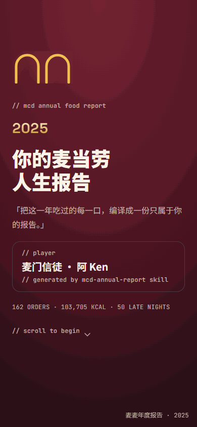
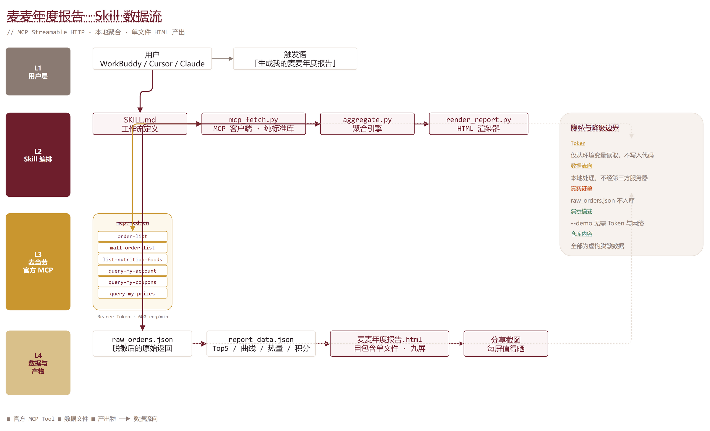

<div align="center">

# 麦麦年度报告 · McDonald's Annual Food Report

**把这一年吃过的每一口，编译成一份只属于你的报告。**

接入**麦当劳官方 MCP Server**，把一年的点单史变成一份 Wrapped 式的九屏个人报告。

[](https://github.com/vvvvv20252025/mcd-annual-report)

`162 ORDERS · 103,705 KCAL · 50 LATE NIGHTS` — 这一行，是你的一年。

[九屏速览](#-九屏速览) · [三行命令跑起来](#-三行命令跑起来) · [它到底做了什么](#-它到底做了什么) · [架构](#-架构)

> **如果这个「往回看」的方向你觉得有意思，右上角点个 ⭐ 就是对我最大的支持。**
> 本项目参加麦当劳开发者创新赛，官方排行榜按 Star 数排名。

</div>

---

## 为什么做这个

麦当劳 MCP 大赛上已有大量参赛项目，但你翻一遍就会发现——**它们几乎都在看「前面」**：

| 方向 | 代表问题 | 在看 |
|------|---------|------|
| 省钱 | 下一单怎么用券最划算 | 未来 |
| 营养 | 这顿有多少卡路里 | 当下 |
| 资产 | 我的积分怎么花最值 | 未来 |
| 点餐 | 今晚吃什么 | 未来 |

**没有人往回看。**

于是我做了一件相反的事：把你已经点过的那些单子全部捞出来，算清楚，编成一份报告。

一年下来，你最爱的那个汉堡、哪个月的你点得最凶、凌晨两点半的那一单、还有多少积分白白过期了——这些数据一直躺在你的订单记录里，没人替你读。

> 它不是工具，是一个**回看你自己一年**的东西。

**和其他项目的区别**：

| | 多数项目 | 本项目 |
|---|---|---|
| 时间方向 | 未来（下一餐、下一单） | **过去（你这一年）** |
| 核心输出 | 一次决策建议 | **一份可回顾、可分享的年度档案** |
| 数据组合 | 券 / 菜单 / 营养 | **订单 + 营养 + 积分 + 优惠券 + 奖品**（5 类交叉叙事） |
| 情感落点 | 实用 | **自我表达与社交分享** |

年度报告类内容天然自带「晒图」属性——用户为了展示自己的报告而 Star 项目，这是 Star 数增长最有效的动力。

---

## ✨ 九屏速览

| | 屏 | 内容 |
|---|-----|------|
| **01** | 封面 | 你的年度总览：订单数 / 累计热量 / 深夜单数 |
| **02** | 第一单 | 这一年的第一口，以及它后来重复了多少次 |
| **03** | 最爱 Top5 | 你的本命单品与份额条 |
| **04** | 进食节律 | 逐月曲线，峰值月自动标注 |
| **05** | 热量洞察 | 累计热量 ≈ 多少根红薯；单均热量；夜间热量占比 |
| **06** | 深夜画像 | 你最常下单的时刻，与 5 时段分布 |
| **07** | 积分体检 | 累计 / 过期 / 临期积分体检 |
| **08** | 1024 彩蛋 | 数据驱动的「程序员人格」标签 |
| **09** | 分享海报 | 3:4 比例海报卡，一键截图 |

每屏都是**单 hero 单 accent** 的排版设计——为「值得截图」而生。

---

## 🚀 三行命令跑起来

**只想看效果？不需要任何 Token，不需要联网：**

```bash
git clone https://github.com/vvvvv20252025/mcd-annual-report.git
cd mcd-annual-report && ./run.sh --demo
```

打开 `麦麦年度报告.html` 即可。

**用你自己的真实数据：**

```bash
export MCD_MCP_TOKEN=你的Token    # 申请: https://open.mcd.cn/mcp
./run.sh "你的昵称"
```

<details>
<summary>Windows 用户</summary>

```powershell
$env:MCD_MCP_TOKEN="你的Token"
python scripts\mcp_fetch.py --out raw_orders.json
python scripts\aggregate.py --in raw_orders.json --out report_data.json --nickname "你的昵称"
python scripts\render_report.py --in report_data.json --out "麦麦年度报告.html"
```

</details>

**要求**：Python 3.8+。**无需 pip install** —— 全部只用标准库。

---

## 🔧 它到底做了什么

### 真实调用麦当劳官方 MCP

不是 mock，不是硬编码。本项目实际调用官方 MCP Server 的 **6 个接口**：

| Tool | 拉什么 | 喂给哪一屏 |
|------|--------|-----------|
| `order-list` | 历史订单 | S1 / S2 / S3 / S4 / S5 |
| `mall-order-list` | 近一年商城兑换订单 | S2 / S3 / S6 |
| `list-nutrition-foods` | **官方全量餐品营养数据**（能量/蛋白质/脂肪/碳水/钠/钙） | S4 |
| `query-my-account` | 积分账户 | S6 |
| `query-my-coupons` | 优惠券 | S6 |
| `query-my-prizes` | 积分抽奖奖品 | S7 |

> 热量数字**全部来自麦当劳官方接口**，不做任何人工近似。

### 三个别人不太会处理的细节

**① 订单数 ≠ 件数**

一笔订单可能点了 3 样东西。「今年点了多少次」和「今年吃了多少样」是两个问题，混用会让所有比例失真。本项目全程分离统计。

**② 深夜时刻跨零点**

深夜时段是 22:00→05:59。直接对时刻取平均，22:47 和 00:58 会算出 **12:32** 这种毫无意义的答案。本项目把 22:00 之后的时刻平移到统一时间轴再平均，最后折回真实时刻。

**③ 餐品名对不上营养表**

订单里的「薯条（大）」和营养表里的「薯条」不匹配。本项目按 `原名 → 去规格后缀 → 双向包含` 三级策略匹配；**匹配不上的会被如实报告，不静默丢弃**。

```bash
# 聚合结束会打印：
聚合完成 -> report_data.json
  订单行 162 / 订单数 162 / 营养表 24 项 / 热量 103705 kcal
```

> 上面是仓库内置**脱敏演示数据**（`examples/demo_raw.json`）跑出来的真实输出：
> 162 单 / 303 件商品 / 103,705 kcal / 50 单深夜 / 峰值 6 月 23 单。
> 换成你自己的 Token，数字会跟着变——但口径永远一致。

---

## 🏗 架构



```
用户  →  MCP Client (WorkBuddy / Cursor / ...)
          ↓
      SKILL.md  工作流
          ↓
   ┌──────────────────────────────┐
   │ scripts/mcp_fetch.py         │  纯标准库 MCP Streamable HTTP 客户端
   │ scripts/aggregate.py         │  聚合引擎（订单数/件数分离、跨零点修正）
   │ scripts/render_report.py     │  渲染器
   └──────────────────────────────┘
          ↓
   麦麦年度报告.html   ← 单文件自包含，CSS/JS/SVG 全内联
```

**客户端实现要点**：完整实现 MCP Streamable HTTP 握手（`initialize` → `notifications/initialized` → `tools/call`），自动捕获 `Mcp-Session-Id` 请求头，**同时兼容 SSE（`text/event-stream`）与纯 JSON** 两种响应形态。

---

## 🔒 隐私边界

| | |
|---|---|
| **Token** | 只从环境变量 `MCD_MCP_TOKEN` 读取，绝不写入代码或产出物 |
| **数据流向** | 用户数据在**本地**完成拉取、聚合、渲染，**不经过任何第三方服务器** |
| **仓库内容** | `examples/demo_raw.json` 为**完全虚构**的脱敏数据 |
| **真实订单文件** | `raw_orders.json` 已在 `.gitignore` 中，不会提交 |
| **离线可跑** | `--demo` 模式无需 Token、无需网络，评审者可直接体验 |

---

## 🎯 目标用户

- **爱点麦当劳但从没统计过的人** —— 你不知道自己的深夜指数有多高；
- **在意数据与隐私的人** —— 数据一个字节都不出本地；
- **MCP 开发者** —— 这是一个结构清晰、可直接二次开发的 Skill 范例。

---

## 📁 目录结构

```
mcd-annual-report/
├── SKILL.md                    # Skill 定义（WorkBuddy / Claude / Cursor 可用）
├── run.sh                      # 一键脚本
├── README.md
├── CONTEST_DECLARATION.md      # 参赛声明
├── MCP_INTEGRATION.md          # MCP 集成说明
├── mcp-config.example.json     # 脱敏 MCP 配置
├── workbuddy.md                # WorkBuddy 开发说明
├── scripts/
│   ├── mcp_fetch.py            # MCP 客户端（纯标准库）
│   ├── aggregate.py            # 聚合引擎
│   ├── render_report.py        # 渲染器
│   ├── build_template.py       # 模板派生
│   └── make_demo_data.py       # 脱敏演示数据生成
├── assets/report_template.html # 九屏报告模板
├── examples/demo_raw.json      # 脱敏样例数据
└── docs/
    ├── architecture.png        # 架构图
    └── 引流文案.md              # 四平台分享文案
```

---

## 🤝 二开

报告模板 `assets/report_template.html` 是一个带 `__REPORT_DATA__` 占位符的静态页面，CSS/JS/SVG 全内联。改配色改排版，改这个文件，然后：

```bash
python scripts/render_report.py --in report_data.json --out "你的报告.html"
```

`report_data.json` 的字段结构见 `SKILL.md` 第三节。

---

## 📄 License

MIT

---

<div align="center">

**这个 1024，我做了一个「麦麦年度报告生成器」，让每个爱吃麦当劳的人都能一键把一年的点单史变成值得截图分享的个人史诗。**

`#WorkBuddy` `#1024程序员节`

</div>
